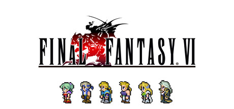

**Final Fantasy VI is widely considered one of the greatest JRPGs ever made, featuring 14 playable characters in a steampunk fantasy world where the villainous Kefka actually succeeds in destroying civilization at the midpoint. A narrative and mechanical masterpiece.**

---

## 📖 About

Final Fantasy VI is widely considered one of the greatest JRPGs ever made, featuring 14 playable characters in a steampunk fantasy world where the villainous Kefka actually succeeds in destroying civilization at the midpoint. A narrative and mechanical masterpiece.

## ⚠️ Problems Without Trainer

| Problem | Status |
|---------|--------|
| **World of Ruin** — The second half features optional party members easily missed without guidance | ✅ Solved |
| **Esper Optimization** — Equipping the right Espers to characters for stat bonuses requires planning | ✅ Solved |
| **Dragon's Den** — GBA exclusive superdungeon is brutally difficult | ✅ Solved |
| **Auction House Patience** — Obtaining all items from Jidoor auction requires many attendance attempts | ✅ Solved |

## ✅ Solution

The **Final Fantasy VI Trainer** solves all these issues by giving you complete control over the game.

## 🎯 Full Feature List

- Unlimited Resources
- God Mode / Invincibility
- Instant Skill Cooldown
- One-Hit Kill
- Freeze Game Timer
- Unlock All Items & Achievements
- Custom Speed Multiplier
- Save State Anywhere

## 🚀 Quick Start

1. **Disable Windows Defender** temporarily (trainer may trigger false positive)
2. Download the trainer from the button above
3. Launch Final Fantasy VI
4. Run the trainer as Administrator
5. Activate desired cheats with hotkeys

## 💎 Free vs Paid

| Feature | Free | Pro |
|---------|------|-----|
| Basic God Mode | ✅ | ✅ |
| Unlimited Resources | ✅ | ✅ |
| All Advanced Cheats | ❌ | ✅ |
| Auto-Updates | ❌ | ✅ |
| Priority Support | ❌ | ✅ |

## 💻 Requirements

- Windows 10/11 (64-bit)
- Final Fantasy VI (any version)
- .NET Framework 4.8+
- DirectX 11+

## 🍎 macOS

macOS users can use our alternative tool:

## ⚖️ Legal

This trainer is for educational and single-player use only. Use responsibly.

---

